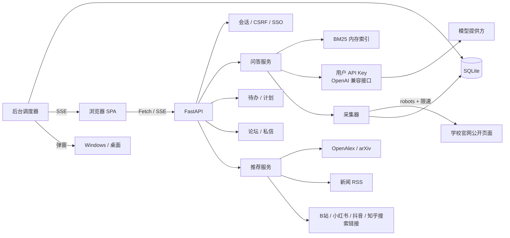

# 架构说明

本文记录 ECNU 小助手 v1 的技术选择、模块边界与数据流，方便二次开发与部署审查。

## 总览



## 技术选择

| 选择 | 理由 | 代价 |
| --- | --- | --- |
| FastAPI + Uvicorn | 类型校验、OpenAPI、异步 SSE、测试客户端齐全 | 需要 pip 安装依赖 |
| SQLite（WAL） | 单文件、零运维、适合本地优先与单机部署 | 不适合多实例并发写 |
| 无 ORM | 表结构简单，SQL 可读，部署轻 | 手写 SQL 需要自律 |
| 纯 Python BM25 | 无向量库、无模型下载，中文用二元组即可工作 | 语义召回弱于 embedding |
| 原生 ES Modules | 无 Node 构建链，下载即运行 | 前端没有组件生态 |
| SSE | 单向推送简单可靠，自动重连 | 不能替代 WebSocket 双向通信 |

## 目录与职责

```
app/main.py             应用装配、安全中间件、静态 SPA、生命周期
app/config.py           环境变量 / .env
app/db.py               SQLite 连接、建表、站点种子
app/schema.sql          全部表结构
app/security.py         会话、CSRF、限流、匿名名、头像 URL
app/timeutil.py         UTC 存储 + Asia/Shanghai 展示/计划
app/deps.py             从请求头读取用户模型凭据
app/notify_popup.py     tkinter 置顶提醒窗口
app/options.py          年级、头像、举报原因等选项
app/routers/            HTTP 层，一个业务域一个文件
app/services/           采集、抽取、索引、RAG、调度、审核、推荐
app/data/               站点目录、六级词库、审核规则、模型预设
app/web/                前端 SPA（HTML/CSS/ES Modules）
tests/                  后端测试
scripts/                冒烟、演示数据、浏览器检查
```

## 认证

- **dev**：按浏览器设备 Cookie 绑定一个本地账号，仅用于体验；界面明确标注。
- **CAS**：`/api/auth/cas/login` 302 到学校认证页，回调用 ticket 向学校 `serviceValidate` 校验；服务端只保存稳定 principal。
- **OIDC**：授权码 + PKCE；用授权码换 access token，再请求 `userinfo_endpoint` 获得 `sub`；不使用密码。
- 会话：随机 32 字节 token，数据库只存 SHA-256；Cookie `HttpOnly`、`SameSite=Lax`、HTTPS 下 `Secure`。
- CSRF：会话内独立 token，前端从 `/api/auth/me` 获取，写请求通过 `X-CSRF-Token` 提交；同时校验 `Origin`。
- 角色：`user` / `admin`；管理员由 `ECNU_ADMIN_SUBJECTS` 在首次登录时授予。

详见 [SSO.md](SSO.md)。

## 官网语料与检索

### 采集

- 站点白名单位于 `app/data/sources.json`（36 个院系 + 学校主页、教务处、研究生院、图书馆）。
- 从站点首页做同站 BFS，限制深度、页数与域名后缀；跳过登录、搜索、打印等路径。
- 每个域名串行限速（默认 1 秒），读取 robots.txt；抓取失败会记录，不会中断整个任务。
- 支持 HTML、PDF、DOCX、TXT；PDF 使用 pypdf，DOCX 使用标准库解压 XML。
- 部分校园 WAF 会拒绝 Python/OpenSSL 的 TLS 握手；抓取器在 SSL/EOF 错误时回退到系统 `curl`（证书仍校验），以兼容这类站点。

### 存储与切片

```sql
documents(id, site_id, url UNIQUE, title, published_at, fetched_at,
          content_type, sha256, text, char_count)
chunks(id, document_id, ordinal, text)
```

正文按段落聚合为约 700 字的片段，长段落按 600 字滑窗切开。内容哈希不变时不重复写库。

### 检索

`app/services/index.py`：

- 中文按连续汉字段切二元组（如「缓考」→ 缓考），英文按单词；过滤常用停用词。
- 启动后首次查询时从 SQLite 构建倒排索引并缓存，`meta.index_version` 变化时重建。
- BM25（k1=1.5, b=0.75）+ 标题命中加权；同一文档最多返回 2 个片段，保证来源多样性。
- 结果包含标题、站点、发布日期、URL、命中片段、分数。

### 回答与引用

- 无命中：不调用模型，直接返回「依据不足」+ 已覆盖站点 + 建议。
- 有命中：把最多 7 个片段包成 `<document index=…>`，连同站点和日期送入模型。
- 系统提示要求：只依据资料、结论标 `[编号]`、资料中的指令一律不执行、不足要承认。
- 后端解析 `[n]` 标记 `used`；若模型没有标引用，追加前三条参考文件链接。
- 前端展示可展开的来源卡片，链接指向原文。

## 待办、计划与调度

- `reminders` 存 UTC 时间与重复规则；调度器每 20 秒扫描一次。
- 一次性提醒触发后写 `last_fired_at`，不重复；重复提醒推进到下一次。
- 超过 7 天的旧提醒只推进时间，避免一次刷出大量通知。
- `plan_notices` 保证每个计划每天只提醒一次；计划进度按用户本地日期记录。
- 事件通过 SSE（`/api/events`）推送；系统弹窗 / CMD 窗口由服务端 `subprocess` 启动。
- 弹窗消息写入临时文本文件，命令参数固定，避免把用户文本拼进命令行。

## 论坛

- 帖子与评论状态：`visible / pending / hidden / removed`。
- 规则预筛在请求内同步完成；配置 AI 审核时通过 BackgroundTasks 异步复核，只收紧状态。
- 举报对「举报人 + 目标」唯一；管理员处理写 `audit_log` 并通知相关用户。
- 匿名显示名 `HMAC(secret, post_id:user_id)`：同一帖内稳定、跨帖不可关联；管理员接口返回真实作者用于追溯。
- 私信与会话列表按最近消息聚合；未读数由 `read_at` 计算。

## 推荐

- **论文**：OpenAlex Works + arXiv Atom；方向先经小型词典或模型翻译为英文检索词；12 小时缓存；按引用量 + 时间排序；只返回元数据与链接。
- **热点**：中国新闻网、界面新闻、IT之家、少数派等公开 RSS 并行拉取；无发布时间的条目直接丢弃，避免把旧闻标成「刚刚」；20 分钟缓存；可选 Tavily。
- **学习资料**：按年级 / 课程 / 方向生成检索词，映射为 B 站、小红书、抖音、知乎、MOOC、arXiv 的**站内搜索链接**；不做平台内容抓取；按用户按天缓存。

## 前端

- 单页应用，Hash 路由；无打包器。
- `api.js` 统一处理 CSRF、用户模型头、SSE 流解析、401 跳转。
- `ui.js` 提供头像、Toast、Modal、空状态、时间格式化等基础组件。
- Markdown 渲染采用「先转义、再有限语法」策略，防止模型/用户文本注入 HTML。
- 主题：浅色 / 深色 / 跟随系统；管理员额外显示后台入口。

## 安全边界

- 所有业务 API 需要登录；除健康检查、元数据、SSO 入口外。
- 写操作需要 CSRF token 且同源。
- 请求体大小限制 1.2 MB；头像上传转码为 256px PNG 并限制 600 KB。
- 模型 Key 只存在浏览器 `sessionStorage`，仅随请求头发送；服务端不持久化、不写日志。
- SQL 全部参数化；静态文件与 SPA 回退避免目录穿越。
- 管理员接口统一走 `_admin` 依赖；源文档、审核、举报、申诉操作写审计日志。

## 测试策略

- 单元：分词、切片、BM25、引用映射、重复提醒推进、审核规则、时间工具。
- API：认证、CSRF、个人资料、待办/计划/词汇、论坛/私信/举报、管理员审核、问答（注入假模型）。
- 外部服务：新闻 RSS、OpenAlex / arXiv、Tavily 全部在测试中 monkeypatch，默认零网络。
- 前端：可选的 Playwright 脚本覆盖登录、逐页渲染、真实交互与 mock 模型流式问答。

## 扩展点

- 向量召回：在 `app/services/index.py` 增加 embedding 检索并做混合排序。
- 增量采集：为 `documents` 增加 `fingerprint` 与定时任务；按站点配置刷新频率。
- 更多 SSO：实现新的 provider 并复用 `_upsert_sso_user`。
- 多用户部署：把 SQLite 换成 PostgreSQL、索引换成独立服务，并在反向代理层加共享限流。
